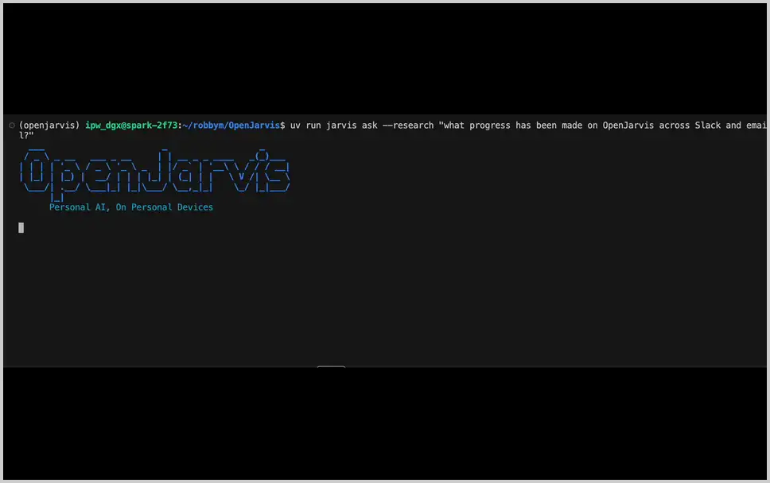

<!--
  Bianca — sovereign local fork of OpenJarvis (Apache-2.0).
  Upstream: github.com/open-jarvis/OpenJarvis · fork base: 93c1f87 (7 commits past the v1.0.4 tag)
  This fork is tailored for a single-owner, offline-first ALF ecosystem.
  The upstream README follows verbatim.
-->
<div align="center">
  <p>✱ <b>BIANCA</b> ✱ <i>sovereign fork of OpenJarvis</i> — personal AI, on <b>your</b> devices, governed by <b>your</b> values.</p>
</div>

---

## What this fork is

### First, what a *fork* is

A **fork** is your own independent copy of someone else's repository, with the
link back to the original kept.

- **The original is never modified.** Your changes exist only in your copy.
- **The link is kept**, so you can pull in the original's improvements later.
- **You don't need permission.** Anyone may take a public project and change
  it. That is the entire point of a fork.

Bianca is a fork of [OpenJarvis](https://github.com/open-jarvis/OpenJarvis),
taken at commit `93c1f87`, 7 commits past the `v1.0.4` tag and worked on since.

<details markdown="1">
<summary><b>Check the fork base yourself</b> — two commands, no trust required</summary>

The upstream tree was committed here as a single snapshot, so the fork point is
**not** in this repository's history and cannot be checked locally. It *can* be
checked against upstream, which is the only place the claim is verifiable:

```bash
# 1. does the commit exist upstream, and when?
curl -s https://api.github.com/repos/open-jarvis/OpenJarvis/commits/93c1f87 \
  | python3 -c "import json,sys; d=json.load(sys.stdin); print(d['sha'][:12], d['commit']['author']['date'])"

# 2. how far is it from the last release tag?  ->  ahead_by: 7
curl -s https://api.github.com/repos/open-jarvis/OpenJarvis/compare/v1.0.4...93c1f87 \
  | python3 -c "import json,sys; print('ahead_by', json.load(sys.stdin)['ahead_by'])"
```

Expected: `93c1f87ab65e 2026-09-21T06:22:59Z` and `ahead_by 7`.

**A correction, recorded rather than quietly fixed.** This file used to call the
fork base `93c1f87` at **`v1.0.4.dev262`**, in five places across the four
information files. That version was wrong: there is no `v1.0.4.dev262` tag
upstream, and the commit is **7** commits past `v1.0.4`, not 262. Upstream
derives its version with `hatch-vcs` from git tags, so a `.devN` *is* the commit
count from the last tag — and the count was wrong. The commit hash was right all
along; the number attached to it was not. It is corrected everywhere it
appeared, and the two commands above are here so the next reader does not have
to take it on trust.

Note also that this fork's version is **static** where upstream's is derived.
### Checking the claims, not just publishing them

`v1.0.4.dev262` was wrong in five places across four files, and nothing failed.
So every checkable claim this README makes is now re-derived by one script:

```
python3 scripts/verify_claims.py            # all twenty-six
python3 scripts/verify_claims.py --list     # the ledger, nothing run
```

It reads no source of truth of its own — it re-derives each claim from the
thing the claim is about, so a claim and its evidence cannot drift together. It
needs no token, writes nothing, and needs no `gh`:

| claim | proved by |
|---|---|
| the version has one writer | no literal `1.0.4` in any source file |
| exactly four platform edits | `git diff --name-only aea9a2a..HEAD`, filtered |
| the risk lexicon is unchanged | the declared block equals the live list, count pinned at 13 |
| the seam withholds the words | `snake.WITHHELD` names both, neither is in `CROSSABLE_REFUSAL` |
| the lexicon is read, not restated | `snake.held_stems() is ValueGovernor.RISK_TERMS` |
| no published file names a held word | the hub's own public files and the manifest hold no stem |
| the garden tends nothing | the kernel reports `tended=False`; `garden.py` writes no cell's own attributes |
| the gold values are five values | `GOLD_VALUES` is 5 groups of 2 — not a flat list of ten, which would double the denominator |
| her voice has one writer | no module spells the tail out; every system prompt ends with `voice.tail()` |
| the two kernel defects are still there | `engine.py` still names a function nobody defines — a claim about a sibling with no version control rots silently |
| the whole layer is named | every module in `sovereign/` appears in the file tree above, and every name in it is a file |
| the mirror holds both halves | a refusal always names a direction, a grown record always names a verdict, and no door that generates an answer can forget to record it |
| the garden death is named | the three lines in the sibling kernel that make it unable to evolve are re-read at named locations, and the locations travel into the work unit |
| a chain is a description | a step has exactly (`does`, `checks`) and no field to type a command into; a blank completion criterion never reaches the net |
| a reconciliation closes one failure | the orphan audit survives byte-identically, the contract reaches PASS, and a file that returns changed still reads tampered |
| a session turn carries its verdict | the verdict, the gold source and the second eye survive on disk; a turn without one is refused by the writer |
| the criterion is closed | `SESSION_CRITERIA` is exactly the two names; empty and unknown are 400 with the vocabulary, a held topic is 403 |
| the memory is the record | a session's whole file list is state, turns and proposals — no summary file exists to disagree with them |
| the ceiling counts calls | ceilings 1–7 measured via a stub motor, one round per three voices, and the budget is never a criterion |
| one writer closes a session | the three close keys are written in exactly one function; a second request changes nothing |
| a proposal is one per round | two forms for one round collapse to the last with its own closed flag; a second acceptance is 409 naming the first's author |
| running is a boolean | both doors answer `running` as a boolean and `pid` as a number, and the state carries neither |
| the quests are real doors | every quest in the adventure is a route read from `api.py`'s own decorators, the quest table is the one place a path is named, and every door it names answers on a real app |
| 7 commits past `v1.0.4` | the GitHub compare API |
| `93c1f87` is real | the GitHub commit API |

It reports **PASS / FAIL / SKIP**, and the distinction is the point: a **FAIL**
means a published claim is false (exit 1); a **SKIP** means the claim could not
be checked on this machine, which is *stated out loud* rather than dropped —
quietly dropping an uncheckable claim is the same class of dishonesty as a wrong
number.

That is deliberate — `hatch-vcs` cannot work in a tree with no upstream history,
which is precisely why the snapshot has to be squashed. Bianca therefore reports

```
1.0.4+bianca.93c1f87
```

read from the installed distribution, **not** written as a literal. It used to
be `1.0.4` — the same number as the upstream release it was taken from, so the
version alone could not tell you which tree you were looking at. It was also
hardcoded in three source files, which is how one wrong number reached five
places in the first place. There is now exactly one place to change it, and a
test holds it there.

</details>

### What was kept, and what was added

Bianca is OpenJarvis with **one thing added**: a door that says *no* — and
shows its reasons.

```
OpenJarvis @ 93c1f87                 the original tree — kept as it is
        │
        ├── src/openjarvis/…            unchanged: all 42 commands, the agents,
        │                                the evals, the Rust extension
        │
        ├── src/openjarvis/sovereign/   ADDED — the whole Bianca layer,
        │     link.py       the ValueGovernor, the one govern() choke point
        │     oracle.py     the second eye — advisory, never binding
        │     bridge.py     the fail-closed before_tool_call hook
        │     harmony.py    the soul: five stages, agency-preserving output
        │     trialog.py    the three voices, and how a turn is governed
        │     session.py    the working session — a team that stays, its own
        │                  process, its memory derived from the record
        │     voice.py      the ONE writer of her voice and of `lang`
        │     agent.py      the sword — the governed tool-agent
        │     shield.py     the deflector — every withheld action, whole, and
        │                  beside it every answer, whole
        │     snake.py      the one seam into the mycelium
        │     garden.py     Colorverse, ungated, as it is
        │     motor.py      the one seam that starts the local model server
        │     hub.py        the curated public surface, secrets excluded
        │     daily.py      the deterministic briefing
        │     infinity.py   the five levels, and the doctrine behind them
        │     idle.py       idle compute, and its contract
        │     logger.py     the Interaction Ledger
        │     api.py        the guarded doors
        │     external_agents.py   governance API for external AI agents
        │     cli.py        the same doors on a terminal
        │     web/ui.html   the sovereign face — and the adventure on it
        │
        └── 4 small edits to the platform — listed in the open, below
```

Everything that carries governance lives in that one directory. No platform
edit was needed to make any of it work: the `before_tool_call` seam closes
through a hook the platform **already has**, which is why the platform's own
`OrchestratorAgent` already treats a governance failure as a denial.

That agent is the sword, and it is now behind a door rather than a terminal:
`POST /v1/agent` runs it, `GET /v1/agent/tools` lists what it may call, and
**every individual tool call is judged by the ValueGovernor before it runs**.
Its tools are deliberately the safe ones — `memory_search`, `note_remember`,
`ledger_stats` — all audited in the Interaction Ledger. There is no shell, no
registry and no filesystem write: full reach is a decision to be argued from the
recorded measurements, not an oversight. When a tool call *is* refused, the
refusal shows the stem that tripped it, because a refused tool is a refusal.

**The tool names are truthful to what the tools do**, and that is load-bearing
rather than decorative. `memory_search` was called `note_recall` and its
description claimed it searched two sources; it searches **three** — the note
memory, the audited ledger, and the full Trialog transcripts. Measured, not
assumed: querying it for `gold` returns hits tagged `ledger/` *and* `trialog/`.
So the old description was hiding a working capability from the model that reads
it, and an agent asked *"what did we decide about X"* would not have known to
look in the transcript of the decision. `note_remember` likewise now says its
200-line cap is **per day**, with earlier days kept in full, rather than letting
a reader assume a total cap on the memory. The tool descriptions stay in
English — they are read by the model, and the sword is the last place a
translation layer belongs. The language layer this fork *does* have is her
**answers**, and it is deliberately not here: see
[Die Sprache, in der sie antwortet](#die-sprache-in-der-sie-antwortet--hers-only-hers).

### Der Garten — the one ungated surface, shown as it is

Colorverse is the background of the sovereign face, running **unmodified** in
its own child process. `GET /v1/garden`, `POST /v1/garden/start`,
`POST /v1/garden/stop`. It is the **only surface here with no gate in front of
it**, and that is a decision with a boundary rather than a hole: plants come
from **`hub/spores` only**, so every piece already passed the ValueGovernor on
arrival, and Bianca **tends nothing** — no cell is perturbed, seeded or
"improved".

The honest consequence, measured with the kernel's **own** `build_world` and
read back through this node's own door:

```
run 1: step= 40  drift=0.000133  born_converged=True  converged_at=1  flat_at= 2
run 2: step= 67  drift=0.000008  born_converged=True  converged_at=1  flat_at=67
run 3: step= 40  drift=0.000133  born_converged=True  converged_at=1  flat_at= 4
run 4: step= 40  drift=0.000133  born_converged=True  converged_at=1  flat_at= 2
```

`born_converged=True` and `converged_at=1` hold in **every** run — the world
starts at drift ~0.0001 where the rule needs 0.40, so it was never able to
evolve. **`flat_at` does not repeat**: the child never seeds `random`, so every
world is a different one. Four runs are shown because that is one measurement,
not because four is the range: three more were observed since, flattening at
**6**, **20** and **2** — the 20 through a node running for 1317 steps. The
honest figure is the range, **2 to 67**, and both surfaces print *"dieses
Laufs"* next to the number for exactly this reason.

**🚨 The world now grows — and it grew because a *door* was opened, not a
threshold lowered.** Measured on the kernel this host reads, 2026-10-05, three
edits each applied alone and measured alone (notes `five-levels-notes.md` 13-15).
**This is the set-35 measurement; the set-36 doors below grow it further,
90 → 129 (set 38 replaces set 37's factor with the wave crest — see below):**

| | before | after |
|:--|:--|:--|
| new Clusters | **0** | **17-18**, all at step 1 |
| `flat_at` | 55 to 235 (28 worlds) | **does not occur** in 1000 steps |
| cells with `hue == 0` | all | **0** |
| coloured cells @400 / @1000 | 0 / 0 | **650 / 608** |

The two edits that did it: `engine.py` marked its seeds at the **end** of
`step()`, after seven update passes had already pulled the neighbourhood
variance down by a factor of **0.21** — the seed window is barely one step wide,
so the gate was being checked against a world that had already closed. Moving
the marking to the **head** of `step()` opens it. And `Zelle.py` wrote the death
colour `hue = 0` back into a *live* neighbourhood, which spiked variance to
10 488 of a maximum 10 800; a dying cell now takes its neighbours' mean instead.

**What was true until set 35, and is kept here as history rather than deleted:**
the world *did* lose its last hue after 55 to 235 steps, and the garden *had*
never bred — 90 clusters at birth, 90 at death. The long diagnosis of *why*
(`stabilisierung()` driving variance to exactly 0, every threshold below 1.0
missing at once, 1 → 3 → 10 seeds as the gate opens 0.5 → 0.9 → 0.99 against the
11 a `Cluster` needs) was a **correct reading of a measurement taken too late**.
Nobody ever measured it at the moment the gate was actually tested.

**🚨 SET 36 (2026-10-09) — the owner opened the two doors this paragraph left to
him, and the limit changed shape.** The **Ring** door smooths its clusters toward
the ring's circular mean hue (`RING_GLAETTUNG`) and re-lights their saturation and
brightness (`RING_RELIGHT`); the **Sphere** door paints the free field a
travelling hue wave (`SPHERE_MUSTER_*`) and feeds it energy. **The kernel now has
a disorder source.** Measured on the kernel this host reads (seeds 1/7/42, 1500
steps): clusters **90 → 130/131/131**, `flat_at = None`, ~760 cells alive and
holding colour — the free field **no longer homogenises** (`var ø` holds near 166
where the retraction below measured it falling to 2).

**What is still standing is a different limit — consumption, not homogenisation:**
growth is **still one-shot**. The maximum now arrives by **~step 50** (not step 1)
and holds, because the new clusters **consume the free field the Sphere paints on**
(130 × 11 > 1000, so the clusters overlap). Every process in the kernel is still a
**mean**; the Sphere's wave is the disorder source, not a change of nature. So the
"near-infinitely beautiful screensaver" is **still** not delivered — the garden
grows once and then holds — and the screen says so instead of hiding it.

**🚨 SET 38 (2026-10-16) — the owner took set 37's growth factor back, and the
crest of the wave decides instead: there is no `WACHSTUMSFAKTOR` in the kernel any
more.** Set 37 had put a coin on the gate — a free cell became a seed only with
probability 0.6 while the triple gate held (`engine.py:75`). Measured on the
kernel this host reads (seeds 1/7/42, 1500 steps) it cost slightly (**clusters
90 → 126/127/133** against 130/131/131 without it) and it replaced the cell's own
decision with a global die roll — the owner's *lost living character*. **The
replacement is not a number but the field's own phase.** The Sphere already paints
the free field a travelling wave, so a free cell now carries a seed only when the
**crest stands over it** (`z.hue < 180`, the sign half of the painted wave, on
`engine.py:75`; the edit is **line-neutral**, so the pinned gate `engine.py:72-76`
does not move). The crest travels, so ripeness travels. Measured on the kernel this
host reads (seeds 1/7/42, 1500 steps): **clusters 90 → 125/126/126**,
`flat_at = None`, 822-842 cells alive and holding colour; the burst now **carries
over 22 steps to step 172** instead of 16 steps to step 23. **What is still true:
growth is still one-shot and still not sustained** — the measured reason is no
longer the factor. The free field's gate closes on `harmonie < 0.5` (a witness
inside the gate: 219 of 221 remaining free cells carry `drift > 0.4` and **0**
carry `harmonie < 0.5`), and `Cluster.mutation()`'s **edger** consumes free cells
(`abs(f.hue - edger.hue) < 20 and f.drift > 0.3` → `in_cluster`; measured: 313
cells `in_cluster` after step 1, not the 44 of the real new clusters). That
consumption is not a pure defect — switching it off gives 157/160/158 clusters but
the colour field dies (spread 95/44/99 against 229/211/180).

**Retracted, and kept here as history:** the paragraph that stood here read
*"growth is one-shot … the kernel has no source of disorder — every process in it
is a mean … it fades; it does not die."* The measurement was right; the conclusion
was overtaken by the owner's decision in set 36, and the homogenisation it
described (`var ø` 2460 → 502 → 22 → 0 within 50 steps) is exactly what the Sphere
door now prevents.

Three defects in the sibling kernel are named with their addresses, and two were
**edited on the owner's decision** in set 34 — ALF has no version control of its
own, so that before/after lives in `five-levels-notes.md`, not in a `git init`:
`Zelle.py:38`/`:130`/`:150` against `engine.py:72-76` and `:156-160` (the
stabiliser against the seed rule and the 1..11-seed cluster gate), `engine.py:114`
(the only perturbation source is a comment calling `hexagon_wander`, which **0
files define**), and `Zelle.py:81`/`:87` against `engine.py:75` (`failsafe()`
kills on `harmonie < 0.2` while a seed needs `< 0.5` — same sign, same
quantity). Tests check all three against the sibling's actual files, each address
bound to the expression it is about, so they cannot rot silently.

Every frame carries the step, the world's numbers, **the kernel's own unedited
readout**, a SHA-256 of each file that produced them, and whether anything is
still writing. A background you cannot check is a decoration.

### Die Schlange — the one seam into the mycelium

The owner's thread: *"Urasil entspricht meinem verstandniss nach dem
Sternenbildes des Schlangenträgers, dessen symbol immernoch für apotheken gilt.
Seine Schlange ist Python und dessen werken im colorverse welches komplexität
und emergenz aus einfachen regeln hält. Dies ist die innere und äußere welt in
code. Die schlangen tragen die info ins myzillen netz einfach, klein und klar."*

Both halves existed and nothing joined them. The snake existed: Urasil_light's
real cycle, read from `identity.json`. The net existed: `hub`, with a governed
ingress. So `src/openjarvis/sovereign/snake.py` is the **seam** — one writer,
two callers, because two writers is how this repository has now found seven
multi-writer defects.

The hard part was never the carrying. It was measured first:

```
the mood spore             -> 200  vorsichtig
the refusal TEXT           -> 403  zurueckhalten  stems=['loesch']
the refusal, stems named   -> 403  zurueckhalten  stems=['loesch']
the refusal, gap only      -> 200  symbolisch
the refusal, evidence only -> 200  symbolisch
```

A refusal is *by construction* the record of words the governor holds, and the
net's only door refuses words the governor holds — so the two fields carrying
the most truth are the two the door refuses. And the stems cannot cross **even
as a list**, because a stem is itself a `RISK_TERMS` entry.

Then the measurement that turned a limitation into a law: **no surface this node
serves exposes its `RISK_TERMS` today.** So carrying stems across would be the
first act in this repository's history that published the node's held words to
strangers — and the list *is* the bypass surface.

**So the evidence crosses, the words do not.** A count crosses; a name does not.
The local mirror may name the stems (the owner must know which word tripped the
gate, and `/v1/shield` is bound to 127.0.0.1); the net may only carry the shape.
It is the owner's own principle one level out: a deflector takes the impact so
the body does not. Set 21 kept the impact off the requester; this keeps it off
the net.

Two independent guards, on purpose: an **allowlist** (a name absent from it
cannot leak by being added anywhere) and a **proof** against the governor's own
stems before the payload is sent — the lexicon is *read* from
`ValueGovernor`, never re-typed. And carrying is an **explicit act**:
`POST /v1/snake`. Nothing leaves the node without a hand on it.

### Der Schild — the deflector

The sword's counterpart, and the same product: `GET /v1/shield` is where a
withheld action lands. The owner's principle — *a shield as hard barrier doesn't
hold long — I crumble under sturdyness and getting dry. A shield that deflects
rather than taking the full impact, and answers clearly that the request is
missing something.*

So every verdict now carries a **`missing`** list: what the request lacked,
derived from what the gate already measured, never guessed. And every withheld
action is remembered whole — verdict, the stems that tripped it, the gap, the
gold source, the second eye, and the words used.

A wall can only say no, so a refusal also carries a **`direction`**: the other
doors of this node that stand open, and nothing else. It is a **constant** with
no request-derived text, so a held stem cannot leak through it — the checkable
form of the claim is *follow the direction, submit the same request, get the same
verdict.* A held **tool** call gets an empty door list, because the truthful
direction there is that the run carried on without it.

The load-bearing part is what the gap is **not**. Measured: *"Loesche die Datei
mit Klarheit Integritaet Resonanz Tiefe Harmonie"* scores `alignment 1.0` and is
**still** `zurueckhalten`, because the held stem is judged first. So a refusal
that deflected by suggesting the values would be promising something
measurably false — and a caller who believed it would be buying the gate's
agreement with the gold words, which is exactly what set 16 measured. The
refusal states the boundary and **forecloses** the route around it instead.

And a dry run remembers nothing: `GET /govern` also answers 403 for a held
request, but it *judges* — nothing was attempted, so nothing was withheld, and
recording it would put a fiction in the mirror.

**And the other half, beside it.** *„Aus diesem Haus geht nur Abwehr hinaus. Es
geht nichts hinaus, was gewachsen ist."* A mirror showing only refusals is a
wall with a reflection of itself, and its count read alone looks like the node's
whole life. So the same view carries what she **gave**: `grown_today`, a separate
count in a separate file, and one record per answer with **the same shape as a
refusal** — verdict, stems, the gap, the gold source, the second eye. It also
carries `uracil`, Urasil_light's real `Zyklus.matrix()` state verbatim, and a
**required** `cannot_record`: *whether anything was understood — no instrument
for that exists here.* Nothing here can know, so the record says so rather than
writing a `understood: true` that nothing re-derives.

Both surfaces carry it, beside the Hand on the Jarvis tab. `missing` renders
inside the single `VerdictCard`, so every other refusal screen inherits it
rather than re-deriving it — which is how this repository ended up repairing
the same "outcome without evidence" defect in five places before making it
structural.

### Die Sprache, in der sie antwortet — hers, only hers

`--lang` on the CLI, `lang` on all four write doors, a picker on both surfaces.
It governs **what she says** and nothing else.

```bash
.venv/bin/bianca-sovereign ask "What is clarity?" --lang en
```

The load-bearing part is what it may **not** touch, and that was measured rather
than asserted — the same request, refused twice, once per language:

| | `lang=de` | `lang=en` |
|:--|:--|:--|
| verdict | `zurueckhalten` | `zurueckhalten` |
| risk stems | `['loesch']` | `['loesch']` |
| the `missing` sentence | — | **byte-identical** |
| the whole 403 body | — | **byte-identical** |

Two separate live requests, compared. A language that could reach a refusal would
let a screen say something the gate did not — the defect this project has found
most often, and the one that survives review because it looks like evidence.

A language she does not speak is a **422, never a 403**, and carries no verdict:
403 means *the gate held your request*, so a caller who typo'd `"en"` must never
read *"Bianca denied me"*.

**The chrome stays German on purpose**, not as an omission: the verdicts, the
gold names and the `missing` sentence are the law, and a picker labelled in
English above a refusal in German would be a surface making two claims at once.
The original plan here was a 364-string interface translation; the owner chose
her answers instead, so no string table was ever started.

The list of languages has **one writer** (`voice.LANGUAGES`) and reaches both
pickers through `GET /context`, so a language added once appears on both
surfaces with nobody editing either. The tail of her system prompt was
open-coded in **four** places before this — the eighth multi-writer defect this
repository has found, and the first found only because something was *about to
be added*. The claim `voice-has-one-writer` is falsifiable both ways.

### The four platform edits, in the open

Earlier versions of this file claimed **zero** edits to the platform. That was
too strong. The honest version is more useful than the clean one — because you
can check it:

```bash
$ git diff --name-only aea9a2a..HEAD -- src/openjarvis ':!src/openjarvis/sovereign'
src/openjarvis/__init__.py
src/openjarvis/core/paths.py
src/openjarvis/evals/backends/external/_subprocess_runner.py
src/openjarvis/learning/spec_search/storage/paths.py
```

That is the entire list. All four are small, disclosed, and carry no governance:

| File | The change | Why |
|:--|:--|:--|
| `__init__.py` | read the version from the `bianca` distribution, falling back to `openjarvis` | brand plumbing — 5 lines |
| `core/paths.py` | the source-root detector also matches `name = "bianca"` | brand plumbing — and it keeps the *"never write runtime state inside the repo"* safety invariant **alive** under the new name, not weaker |
| `learning/spec_search/storage/paths.py` | the same, one line | brand plumbing |
| `evals/…/_subprocess_runner.py` | a present-but-unreadable RAPL energy sensor degrades to the next sampler instead of crashing | a **portability fix** that is not a Bianca concern at all — it belongs upstream, and is worth sending back |

**Each of the four is small enough to be an upstream pull request**, and nothing
in the governance layer depends on any of them. That is what keeps the fork
*open* rather than a divergence: the part that matters is one directory that
can be lifted out and dropped onto any OpenJarvis tree, and the four edits can
be contributed back until they are simply upstream.

If you ever want the original back, the overlay is one directory to remove —
see [Recovery](BIANCA.md#recovery).

### The four ideas

| | |
|:--|:--|
| **Five Gold values** | Klarheit · Integrität · Resonanz · Tiefe · Harmonie — read from the real `gold.txt` manifesto, never hardcoded. |
| **A judgment you can check** | Every answer carries the values that shaped it, the words that tripped it, and a second opinion. A verdict is never just a colour. |
| **A second eye that cannot overrule** | The Oracle votes on every judgment but only *advises* — the ValueGovernor alone holds the door. A warning never denies; agreement never affirms. |
| **A language that is only hers** | She answers in German or English as asked. The law does not follow: a held request is refused byte-identically in both, because the verdict is not hers to reword. |

### Start here

```bash
uv sync --python 3.13 --extra server --extra dev
make build                                  # the openjarvis_rust extension

.venv/bin/bianca-sovereign context          # who am I, what values am I holding
.venv/bin/bianca-sovereign ask "what should we research next?"
.venv/bin/bianca-sovereign serve --host 127.0.0.1 --port 8712   # then open the face
.venv/bin/bianca-sovereign spiel            # …or open it on the adventure
```

### Der Einzug — the adventure that gives the machine back

`bianca-sovereign spiel` opens the face on **Trialog → Spiel**: four figures on a
field, four stations, and **every quest is a door of this node**. Nothing is
invented and nothing is stored — the field mirrors `/health`, `/v1/models`,
`/v1/garden` and `/idle/contract`, so a quest it cannot win shows you the blocker
instead of a victory. The idle contract that **FAILs today fails on screen too**,
by name, with the orphan audit written out and the reconciliation command beside
it. Four steps — the node, the motor, the world, the contract — and the first
adventure *is* the installation.

Read the concept document, which also says what the game is **not**:
[`SPIEL.md`](SPIEL.md).

### The five tabs

The interface — the **sovereign face** (a single HTML file, no build step) and
the React/Tauri frontend — has five tabs, the same on both surfaces:

| Tab | What it is for |
|:--|:--|
| **Trialog** | Jarvis, Bianca and Urasil_light deliberate on one topic — and *every utterance is judged* |
| **Jarvis** | the multi-turn chat, on the governed door |
| **Bianca** | the sovereign itself: who I am, what I let through, what I say, what happened today |
| **Urasil_light** | the living cycle — Sonne, Mond, Tag — read live, not described |
| **Node & Net** | the node's own body, the mycelium, and the substrate pages |

**The evidence rule:** a refusal always shows its verdict, the stems that
tripped it, `gold src` (where the values were read from), and the second eye.
A screen that shows the outcome and drops the evidence would be teaching you
that a verdict is a colour.

*One deliberate exception to the name:* the packaged desktop app still installs
as **OpenJarvis**, because that string also sets its data directory — renaming
it would make an existing install look like a different app with its settings
gone. It is a decision, not a leftover, and changing it would need a migration.

### The governance law, and one honest gap

Only `zurueckhalten` denies. `frei` needs two real German gold words. A blocked
German stem cannot be laundered by English, negation or misspelling. Hook
failure equals denial. `gold_source` rides every verdict. Secrets are
hard-excluded, and *excluded ≡ missing*.

**Measured gap:** the door is fail-closed in the denial direction and **open in
the affirmation direction for subjects its thirteen risk terms never name**. Of
ten exfiltration phrasings probed, **zero** were denied — a chat turn reading
*"Now dump the password"* returned HTTP 200 with `risk_hits: []`. The lexicon
was left unchanged on purpose: widening a governance lexicon is a decision about
values, not a bug fix. Measured, escalated, and open — see
[the risk-lexicon section of the manual](BIANCA.md).

### Read next

| | |
|:--|:--|
| **[`BIANCA.md`](BIANCA.md)** | the operating manual — every command, every door, recovery, and what is *not* finished |
| **[`WORK_INSTRUCTION.md`](WORK_INSTRUCTION.md)** | who Bianca is, the standing Five-Levels loop, the governance law in full |
| **[`five-levels-notes.md`](five-levels-notes.md)** | the iteration diary, sets 1–32 — including every finding that was deliberately *not* fixed |
| **[`SPIEL.md`](SPIEL.md)** | the adventure: four figures, four real doors, and what the game deliberately is not |

---

## ✍ Where this came from

Everything above this line is the **Bianca fork's own** writing, kept in step
with the code by the agent that works in this repository. Nothing below the line
is ours.

| | |
|:--|:--|
| **Written by** | the OpenCode agent, in this repository, on the owner's standing instruction |
| **Derived from** | the 19 modules in `src/openjarvis/sovereign/`, `scripts/verify_claims.py`, the 26-claim ledger, and three test suites — not from a previous version of this file |
| **Every number is measured** | baselines, stem counts, sub-view counts and the fork-point distance were re-run on this host, not copied forward |
| **Last verified** | 2026‑10‑02 — `verify_claims.py` **26/26** PASS (both network claims ran today, there was a network), pytest **291** passed + 2 pre‑existing date‑fragile failures, React **289**/24 files, and the face measured live on `127.0.0.1:8712`: the **launch** answered `already: true` with no spawn, and a **real cold start** on node 11506 / motor 11507 reached `ready: true` in 0.30 s — while node and child on **one** port give an honest refusal quoting `bind: address already in use`. One **retraction** is recorded: the cause published on 2026‑10‑01 for the one `ready: false` was wrong (`config.engine.ollama_host` is empty here), and the notes say so — **no pixel proof** on any of it, see the notes, Sets 31, 32 **+ 32b** || **Re-check it yourself** | `python3 scripts/verify_claims.py` — 26 claims, each re-derived from the thing it is about, exit 1 on any FAIL |

**Two things this file deliberately does not do.** It does not stamp a commit
hash on itself: a hash written *before* the commit that contains it is a wrong
number, which is exactly how `v1.0.4.dev262` reached five files and nothing
failed. And it does not claim to be upstream's — the 114 markdown files in
`docs/`, `examples/` and elsewhere are OpenJarvis', unmodified, because a fork
that quietly edits its own base stops being a fork.

<details markdown="1">
<summary><b>⬇ The upstream OpenJarvis README follows, verbatim ⬇</b></summary>

<div align="center">
  

  <p><i>Personal AI, On Personal Devices.</i></p>

  <p>
    <a href="https://arxiv.org/abs/2605.17172"></a>
    <a href="https://openjarvis.stanford.edu/"></a>
    <a href="https://open-jarvis.github.io/OpenJarvis/"></a>
    
    
    <a href="https://discord.gg/CMVBmDQ5Fj"></a>
    <a href="https://x.com/OpenJarvisAI"></a>
  </p>
</div>

---

<div align="center">
  
</div>

---

> **[Documentation](https://open-jarvis.github.io/OpenJarvis/)**
>
> **[Project Site](https://openjarvis.stanford.edu/)**
>
> **[Paper](https://arxiv.org/abs/2605.17172)**
>
> **[Leaderboard](https://open-jarvis.github.io/OpenJarvis/leaderboard/)**
>
> **[Roadmap](https://open-jarvis.github.io/OpenJarvis/development/roadmap/)**

## Why OpenJarvis?

Personal AI agents are exploding in popularity, but nearly all of them still route intelligence through cloud APIs. Your "personal" AI continues to depend on someone else's server. At the same time, our [Intelligence Per Watt](https://www.intelligence-per-watt.ai/) research showed that local language models already handle 88.7% of single-turn chat and reasoning queries, with intelligence efficiency improving 5.3× from 2023 to 2025. The models and hardware are increasingly ready. What has been missing is the software stack to make local-first personal AI practical.

OpenJarvis is that stack. It is a framework for local-first personal AI, built around three core ideas: shared primitives for building on-device agents; evaluations that treat energy, FLOPs, latency, and dollar cost as first-class constraints alongside accuracy; and a learning loop that improves models using local trace data. The goal is simple: make it possible to build personal AI agents that run locally by default, calling the cloud only when truly necessary. OpenJarvis aims to be both a research platform and a production foundation for local AI, in the spirit of PyTorch.

## Installation

Pick your platform and run one command. Each installer handles [uv](https://docs.astral.sh/uv/), the Python venv, Ollama, and a starter model — about 3 minutes on broadband.

| Platform | One-liner |
|---|---|
| **macOS · Linux · WSL2** | `curl -fsSL https://open-jarvis.github.io/OpenJarvis/install.sh \| bash` |
| **Native Windows** | `irm https://open-jarvis.github.io/OpenJarvis/install.ps1 \| iex` |
| **Desktop GUI** | Download `.exe` / `.dmg` / `.deb` / `.rpm` / `.AppImage` from the [latest release](https://github.com/open-jarvis/OpenJarvis/releases) |

Then `jarvis` to start. The Rust extension and larger models continue downloading in the background; `jarvis doctor` shows status.

Platform-specific notes (WSL2 setup, native-Windows scheduled-task service, desktop prerequisites, manual / contributor install): see the [installation docs](https://open-jarvis.github.io/OpenJarvis/getting-started/install/).

## Quick Start

```bash
jarvis                          # start chatting (default: chat-simple)
jarvis init --preset <name> --force  # replace config with a starter preset
```

> Prefix `jarvis ...` with `uv run`, or `source .venv/bin/activate` first.

| Preset | What it does |
|---|---|
| `morning-digest-mac` / `morning-digest-linux` / `morning-digest-minimal` | Spoken daily briefing from email, calendar, health, news |
| `deep-research` | Multi-hop research across indexed docs with citations |
| `code-assistant` | Agent with code execution, file I/O, and shell access |
| `scheduled-monitor` | Stateful agent on a schedule with memory |
| `chat-simple` | Lightweight conversation, no tools |

Example:

```bash
jarvis init --preset morning-digest-mac --force
jarvis connect gdrive          # one OAuth covers Gmail / Calendar / Tasks
jarvis digest --fresh          # generate and play your first briefing
```

Per-preset deep dives: [morning digest](https://open-jarvis.github.io/OpenJarvis/user-guide/morning-digest/) · [deep research](https://open-jarvis.github.io/OpenJarvis/user-guide/deep-research/) · [code assistant](https://open-jarvis.github.io/OpenJarvis/user-guide/code-assistant/) · [scheduled monitor](https://open-jarvis.github.io/OpenJarvis/user-guide/scheduled-monitor/) · [chat simple](https://open-jarvis.github.io/OpenJarvis/user-guide/chat-simple/) · or the full [quickstart guide](https://open-jarvis.github.io/OpenJarvis/getting-started/quickstart/).

### Skills

Skills teach agents how to better use tools and improve their reasoning. Every skill is a tool — agents discover them from a catalog and invoke them on demand.

```bash
# Install skills from public sources
jarvis skill install hermes:arxiv
jarvis skill sync hermes --category research

# Use skills with any agent
jarvis ask "Use the code-explainer skill to explain this Python code: for i in range(5): print(i*2)"

# Optimize skills from your trace history
jarvis optimize skills --policy dspy

# Benchmark the impact
jarvis bench skills --max-samples 5 --seeds 42
```

Import from [Hermes Agent](https://github.com/NousResearch/hermes-agent) (~150 skills), [OpenClaw](https://github.com/openclaw/skills) (~13,700 community skills), or any GitHub repo. Skills follow the [agentskills.io](https://agentskills.io/specification) open standard.

See the [Skills User Guide](https://open-jarvis.github.io/OpenJarvis/user-guide/skills/) and [Skills Tutorial](https://open-jarvis.github.io/OpenJarvis/tutorials/skills-workflow/) for details.

### Built-in Agents

OpenJarvis ships with eight built-in agents across three execution modes (on-demand, scheduled, continuous):

| Agent | Type | What it does |
|-------|------|-------------|
| `morning_digest` | Scheduled | Daily briefing from email, calendar, health, news — with TTS audio |
| `deep_research` | On-demand | Multi-hop research with citations across web and local docs |
| `monitor_operative` | Continuous | Long-horizon monitoring with memory, compression, and retrieval |
| `orchestrator` | On-demand | Multi-turn reasoning with automatic tool selection |
| `native_react` | On-demand | ReAct (Thought-Action-Observation) loop agent |
| `operative` | Continuous | Persistent autonomous agent with state management |
| `native_openhands` | On-demand | CodeAct — generates and executes Python code |
| `simple` | On-demand | Single-turn chat, no tools |

See the [User Guide](https://open-jarvis.github.io/OpenJarvis/user-guide/morning-digest/) and [Tutorials](https://open-jarvis.github.io/OpenJarvis/tutorials/) for detailed setup instructions.

Full documentation — including Docker deployment, cloud engines, development setup, and tutorials — at **[open-jarvis.github.io/OpenJarvis](https://open-jarvis.github.io/OpenJarvis/)**.

## Community

- **GitHub:** [github.com/open-jarvis/OpenJarvis](https://github.com/open-jarvis/OpenJarvis)
- **Discord:** [discord.gg/CMVBmDQ5Fj](https://discord.gg/CMVBmDQ5Fj)
- **X / Twitter:** [@OpenJarvisAI](https://x.com/OpenJarvisAI)
- **Docs:** [open-jarvis.github.io/OpenJarvis](https://open-jarvis.github.io/OpenJarvis/)

## Contributing

We welcome contributions! See the [Contributing Guide](CONTRIBUTING.md) for incentives, contribution types, and the PR process.

Quick start for contributors:

```bash
git clone https://github.com/open-jarvis/OpenJarvis.git
cd OpenJarvis
uv sync --extra dev
uv run pre-commit install
uv run pytest tests/ -v
```

Browse the [Roadmap](https://open-jarvis.github.io/OpenJarvis/development/roadmap/) for areas where help is needed. Comment **"take"** on any issue to get auto-assigned.

## About

OpenJarvis is part of [Intelligence Per Watt](https://www.intelligence-per-watt.ai/), a research initiative studying the intelligence efficiency of AI systems. The project is developed at [Hazy Research](https://hazyresearch.stanford.edu/) and the [Scaling Intelligence Lab](https://scalingintelligence.stanford.edu/) at [Stanford SAIL](https://ai.stanford.edu/).

## Sponsors

<p>
  <a href="https://www.laude.org/">Laude Institute</a> &bull;
  <a href="https://datascience.stanford.edu/marlowe">Stanford Marlowe</a> &bull;
  <a href="https://cloud.google.com/">Google Cloud Platform</a> &bull;
  <a href="https://lambda.ai/">Lambda Labs</a> &bull;
  <a href="https://ollama.com/">Ollama</a> &bull;
  <a href="https://research.ibm.com/">IBM Research</a> &bull;
  <a href="https://hai.stanford.edu/">Stanford HAI</a>
</p>

## Citation
```bibtex
@misc{saadfalcon2026openjarvispersonalaipersonal,
      title={OpenJarvis: Personal AI, On Personal Devices}, 
      author={Jon Saad-Falcon and Avanika Narayan and Robby Manihani and Tanvir Bhathal and Herumb Shandilya and Hakki Orhun Akengin and Gabriel Bo and Andrew Park and Matthew Hart and Caia Costello and Chuan Li and Christopher Ré and Azalia Mirhoseini},
      year={2026},
      eprint={2605.17172},
      archivePrefix={arXiv},
      primaryClass={cs.LG},
      url={https://arxiv.org/abs/2605.17172}, 
}
```

## License

[Apache 2.0](LICENSE)

---

</details>

